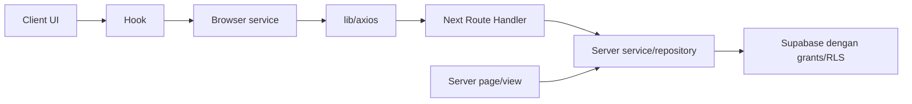

# Arsitektur aktual — F01

Fondasi Next App Router, React 19, Node 24, TypeScript strict. `/` masih scaffold. F01 tidak membuat domain, API endpoint, tabel, admin UI, atau chatbot.

Panah adalah kontrak boundary, bukan klaim layer domain sudah diimplementasikan. Service/hook/domain ditambah saat fitur pemakainya dibuat; RSC tidak self-fetch API.

## Modul yang tersedia

| Lokasi                                              | Perilaku aktual                                                                                                                    |
| --------------------------------------------------- | ---------------------------------------------------------------------------------------------------------------------------------- |
| `src/constants`                                     | Home/base API, namespace Query, stale/retry/timeout/limit/error copy; tanpa endpoint fitur palsu                                   |
| `src/types/api.ts`, `src/validations/api.schema.ts` | Envelope success/error, pagination typed, validasi output strict                                                                   |
| `src/config/environment.client.ts`                  | Referensi NEXT_PUBLIC eksplisit untuk substitusi build Next; tanpa provider/server key                                             |
| `src/config/environment.server.ts`                  | server-only; APP_ENV dan provider flag, fail-closed sampai F23 dipilih                                                             |
| `src/config/parse-environment.ts`                   | Error hanya nama key, tanpa input/cause/ZodError/nilai rahasia; termasuk exception custom refinement                               |
| `src/lib/axios`                                     | BFF relatif, timeout, AbortSignal, satu validasi/unwrap; mempertahankan data/requestId/meta/pagination; tanpa toast/log raw config |
| `src/lib/errors.ts`                                 | Error sanitized, retry terbatas; 4xx/abort/invalid response tidak diulang                                                          |
| `src/lib/response.server.ts`                        | JSON no-store, validasi success dan failure generik; belum ada handler domain                                                      |
| `src/lib/query-client.ts`, `src/providers`          | QueryClient per mount, stabil saat rerender; mutation tidak auto-retry; layout tetap RSC                                           |
| `src/utils/cn.ts`                                   | clsx + tailwind-merge, dipakai layout. Provider tanpa DOM hanya menerima children                                                  |
| `tooling/eslint/architecture.mjs`                   | Boundary alias/relative/dynamic import/re-export, UI/hook/service/transport/domain/pure modules dan larangan barrel server         |

Barrel constants/types/utils/config/providers/lib-axios client-safe; server-only diimpor langsung. Type-only imports dan larangan explicit any diperiksa ESLint. Compiler Next tetap menjadi gate transitive client/server, bukan digantikan lint.

## Environment sebelum DB

`.env.example` berisi defaults nonrahasia dan credential kosong. Root scaffold memvalidasi nilai yang terisi; URL/key DB kosong diperbolehkan sebelum fitur DB ada. Adapter Supabase selalu mewajibkan keduanya saat dipanggil; tidak mengganti kegagalan dengan data palsu. Public key hanya menerima format publishable atau legacy JWT role anon dan menolak secret/service-role. Ini bukan verifikasi signature atau bukti RLS.

Boolean hanya string true/false. Provider disabled tidak memerlukan key/model; aktivasi ditolak sampai F23. Belum ada provider SDK/limiter. NEXT_PUBLIC dibundel saat build dan memerlukan rebuild ketika diubah. Server env tidak masuk barrel browser.

## Konteks Supabase dan cookie bridge

- `lib/supabase/client.ts`: SSR browser Auth adapter saja, bukan CRUD bisnis.
- `lib/supabase/server.ts`: client per request dengan await cookies. Tanpa response adalah RSC read-only; Route Handler wajib mengoper NextResponse untuk meneruskan cookie dan header cache SDK, lalu mengembalikan response tersebut atau menyalinnya secara utuh.
- `lib/supabase/proxy.ts` dan `src/proxy.ts`: refresh getClaims, akumulasi semua chunk cookie pada request/response dan header argumen kedua setAll. Matcher literal hanya scope admin/auth; chat/checkout publik tidak ikut refresh. Literal diperlukan static analysis Next. Proxy bukan guard role/profile/revocation F15.
- `lib/supabase/public-read.server.ts`: client anon baru tanpa persistence/refresh/session detection, fetch no-store/credentials omit, cookie dihapus dan apikey/Authorization dipatok ke public key. Tidak menerima request/admin JWT/service-role. Belum ada chat/query domain.

Bridge mengikuti [Supabase SSR](https://supabase.com/docs/guides/auth/server-side/creating-a-client) dan signature SDK terpasang 0.12.7. Client SSR tidak disimpan global. Dengan Cache Components, ikuti docs Next terpasang, bukan konfigurasi route/cache lama. Semua public DB fetch baseline uncached.

Schema/constraints F02 dan data/tooling F04 ada di [database.md](database.md). `src/types/database.ts` dihasilkan CLI schema aktual dan digunakan sebagai generic semua helper Supabase; tidak ada placeholder types manual. Grants/RLS/RPC/Storage F03 dan tes JWT/REST/SDK nyata dijabarkan di [security.md](security.md). Actual public read adapter diuji tetap anonymous meski diberi session owner; bukti mock F01 hanya kontrak adapter. Endpoint chat/admin belum ada; regression dan audit handler berikutnya tetap wajib.

## Tooling

F06 menambah `(site)` server layout dan directory branches saja. Public shell, Zustand preference, query/service/BFF/domain/repository dan kontrak fallback/guard F12 dijelaskan pada [branches.md](branches.md). RSC tidak self-fetch; browser tidak mengakses Supabase bisnis. Chat hanya satu slot informatif. Halaman tujuan yang belum diimplementasikan memakai bounded preparation view, bukan fitur domain.

Vitest memisahkan project unit/DOM/server dengan inheritance eksplisit, pool threads, satu worker, serial file scheduling dan isolation tetap aktif. Ini membatasi beban startup Windows, tanpa mengurangi assertion atau mengubah timeout produk. Hanya project server menunjuk entry kosong asli server-only; alias itu tidak berlaku pada browser/build. `test:boundaries` memakai compiler Next asli (webpack) dan modul environment server proyek: import harus berhasil di RSC dan ditolak di Client Component. Production build aplikasi memakai Turbopack. Fixture memakai env bersih; cleanup hanya pada temp path terverifikasi.

Playwright memakai next start dari production build lokal port 3100 untuk komposisi F05. Vite loopback 3101 hanya menyajikan fixture interaksi di tests/fixtures/ui dan memuat stylesheet/font hasil build Next melalui proxy /_next. Tidak ada route playground pada aplikasi produksi. Browser menguji native modal/inert, endpoint wrapping Tab, return fokus, cleanup/scroll lock bertingkat, field/error/quantity, axe, viewport dan CSS zoom; bukan domain storefront/DB. Detail API/token dan batas bukti ada di [DESIGN.md](../DESIGN.md). Sejak F02 `test:db` menjalankan pgTAP constraints pada fixture rollback dan dua sesi PostgreSQL nyata untuk serialization/write-skew. Tidak ada passWithNoTests atau tes dummy.

CI dasar memakai npm ci/check tanpa secret/DB produksi. Job SQL menjalankan disposable policy stack tanpa seed lalu normal local reset/seed/verify/idempotency/types drift/tooling guards. `db:types:local` buffer UTF-8, format dan temporary rename hanya setelah generator exit 0; tidak menulis partial types. Knip mengecualikan generated types dari unused export pruning karena CLI harus tetap authoritative; source/helper lain tetap diperiksa. Hasil remote CI belum diverifikasi. Domain E2E masuk CI ketika harness terkait ada. Hasil aktual dan NOT RUN ada di [implementation-status.md](implementation-status.md).
