# Database — F02

Bagian F02 berikut adalah snapshot schema awal. Izin runtime terbaru diterapkan F03 melalui `20261112000300_bakery_permissions.sql`; matriks grants/RLS/RPC/Storage dan bukti JWT nyata ada di [security.md](security.md). Tidak menganggap deny-all F02 masih menjadi konfigurasi terkini.

Sumber schema tunggal: `supabase/migrations/20261112000100_bakery_schema.sql` dan `20261112000200_bakery_integrity.sql`. PostgreSQL lokal 17; schema `public` berisi 26 tabel MVP. Tidak ada seed bisnis, tabel fase 2, RPC aplikasi, atau policy runtime. Seluruh tabel public mengaktifkan RLS dalam transaksi pembuatan dan grants anon/authenticated dicabut. Ini belum membuktikan isolasi owner/staff/anon: F03 wajib menguji JWT/direct REST, column grants, dan Storage.

```mermaid
erDiagram
  AUTH_USERS ||--o| ADMIN_PROFILES : identity
  BRANCHES ||--o{ ADMIN_PROFILES : scope
  BRANCHES ||--o{ BUSINESS_HOURS : hours
  CATEGORIES o|--o{ CATEGORIES : parent
  PRODUCTS ||--o{ PRODUCT_CATEGORIES : categorized
  CATEGORIES ||--o{ PRODUCT_CATEGORIES : includes
  PRODUCTS ||--o{ PRODUCT_VARIANTS : skus
  PRODUCTS ||--o{ PRODUCT_IMAGES : media
  PRODUCT_VARIANTS o|--o{ PRODUCT_IMAGES : optional_sku
  BRANCHES ||--o{ BRANCH_VARIANT_OFFERS : lists
  PRODUCT_VARIANTS ||--o{ BRANCH_VARIANT_OFFERS : offered
  PRODUCT_VARIANTS ||--o{ OPTION_GROUPS : bundle
  OPTION_GROUPS ||--o{ OPTION_CHOICES : selects
  PRODUCT_VARIANTS o|--o{ OPTION_CHOICES : component
  PRODUCT_VARIANTS ||--o{ BUNDLE_FIXED_COMPONENTS : parent_and_component
  PRODUCT_VARIANTS ||--o{ VARIANT_DIETARY_TAGS : claims
  DIETARY_TAGS ||--o{ VARIANT_DIETARY_TAGS : taxonomy
  PRODUCT_VARIANTS ||--o{ VARIANT_ALLERGENS : describes
  ALLERGENS ||--o{ VARIANT_ALLERGENS : taxonomy
  PROMOTIONS ||--o{ PROMOTION_BRANCHES : branches
  BRANCHES ||--o{ PROMOTION_BRANCHES : target
  PROMOTIONS ||--o{ PROMOTION_CATEGORIES : categories
  CATEGORIES ||--o{ PROMOTION_CATEGORIES : target
  PROMOTIONS ||--o{ PROMOTION_PRODUCTS : products
  PRODUCTS ||--o{ PROMOTION_PRODUCTS : target
  PROMOTIONS ||--o{ PROMOTION_VARIANTS : variants
  PRODUCT_VARIANTS ||--o{ PROMOTION_VARIANTS : target
  CLASS_PROGRAMS ||--o{ CLASS_SESSIONS : sessions
  BRANCHES ||--o{ CLASS_SESSIONS : hosts
  AUTH_USERS o|--o{ SITE_CONTENT : updated_by
  TESTIMONIALS { uuid id PK }
  FAQS { uuid id PK }
```

## Kontrak constraint

- UUID PK, FK `RESTRICT`, timestamps dan trigger `updated_at` pada semua tabel termasuk pivots. Semua FK memiliki indeks leading yang sesuai. `created_at`, PK, slug/SKU/code immutable; rename display tidak mengubah permalink. Mengganti slug/SKU perlu migration maintenance yang ditinjau, bukan edit nama. Relasi non-PK tetap dapat diedit sepanjang integritas akhir valid.
- Domain private membatasi label 200 karakter, body 10.000 karakter, slug lowercase URL-safe, internal media path 500 karakter, unit IDR 1–1 miliar, nominal nonnegatif sampai 1 triliun. PostgreSQL menghitung panjang Unicode code points; Zod request boundary berikutnya tetap wajib memakai batas UTF-16/UTF-8 PRD. Kuantitas SKU 1–99. Harga maksimum seluruh konfigurasi opsi dan override juga ≤1 miliar; gross cart dibatasi service F11.
- Partial unique: paling banyak satu kategori primary, satu SKU default, satu gambar primary per produk. Composite FK gambar memastikan variant milik produk yang sama. Kategori menolak self/cycle serta published child dengan parent belum published.
- Offer tanpa row bukan offered. `stock_quantity=0` mewajibkan `sold_out`; null berarti tidak dilacak. Hours nullable berarti belum diketahui; interval parsial/terbalik/overnight ditolak.
- Mapping diet pending tidak menjadi klaim publik; verified mewajibkan timestamp. Tidak ada inferensi bebas alergen dari mapping kosong. `note`, `source_note`, consent dan `updated_by` tetap privat; F03 harus menerapkan column/projection grants sebelum SELECT publik.
- Promo memakai numeric(12,2) agar fixed IDR 1 miliar dapat direpresentasikan; percentage ≤100, fixed integer, cap/min-spend nonnegatif ≤1 triliun, finite interval start<end, stackable selalu false. Scope hanya boleh memakai pivot target yang sesuai; scope all tanpa target. Publish scope spesifik butuh target published/active yang valid. Branch pivot kosong berarti seluruh cabang aktif; eligibility waktu/branch/target dan kalkulator diskon F10–F11.
- Class: harga positif, age 0–120 dan min≤max, duration positif, included_items array string ≤50 dengan payload bounded. Session finite start<end, deadline≤start, capacity>0, seats null atau 0..capacity. Registrasi terbuka hanya scheduled, seats tidak nol, branch aktif dan program published. Closed/full boleh tetap tampil setelah F03.

## Publish prerequisites

Validasi aggregate **deferred sampai akhir transaksi**. Perubahan child/category/offer/claim juga memvalidasi ulang parent yang sudah published; tidak cukup hanya menguji tombol publish. Untuk membuat draft baru, konfigurasi boleh belum lengkap. Editor F17 harus menyimpan aggregate secara atomik, atau men-draft parent terlebih dahulu untuk perubahan yang belum lengkap.

| Entitas       | Syarat                                                                                                                                                                                                                |
| ------------- | --------------------------------------------------------------------------------------------------------------------------------------------------------------------------------------------------------------------- |
| Category      | Parent, bila ada, published; graph tanpa cycle                                                                                                                                                                        |
| Product       | Review selesai, minimal satu active SKU (simple tepat satu), minimal satu category published, minimal satu active SKU listed pada branch aktif, minimal satu approved public image dengan alt dan variant null/active |
| Bundle        | Seluruh active SKU published harus recipe verified, 12 slices; parent component published, SKU active, listed di setiap cabang bundle listed; sold-out tetap awareness, belum menjamin bisa dibeli                    |
| Promotion     | Scope/target sesuai; scope spesifik minimal satu target valid published/active; window/cap/status valid; enabled terpisah, bukan bukti sedang berlaku                                                                 |
| Class program | Review selesai, description nonkosong, cover approved di `class-images` beserta path/alt                                                                                                                              |
| Testimonial   | Consent timestamp dan reference nonkosong; rating opsional 1–5                                                                                                                                                        |
| FAQ           | Category/question/answer nonkosong dan bounded; publish status eksplisit                                                                                                                                              |
| CMS           | Key/payload allowlist, field wajib per key, plain text, media approved jika dipakai                                                                                                                                   |

`product_images.storage_bucket/is_approved`, class cover bucket/approval/alt/review, dan variant `bundle_recipe/bundle_rules_verified` adalah metadata prasyarat, **bukan bukti objek Storage/izin nyata**. F17 memvalidasi file/izin dan F03 mengamankan kolom/policy. Tidak ada bucket yang dibuat F02.

## Recipe Chiffon Mix

MVP hanya mendukung `bundle_recipe='chiffon_mix'`. Dua fixed slots `cheese`/`choco` ×3; tepat dua required groups min=max=1 dengan **quantity_per_selection=3**. Setiap group memiliki active choice yang menunjuk real component SKU non-bundle; recursion/self dilarang. Dua fixed products berbeda; pilihan tidak boleh sama dengan fixed flavour. Harus tersedia pasangan pilihan dengan dua product IDs berbeda. Product ID adalah identitas rasa; SKU adalah ukuran/formulasi. Owner memetakan slot Cheese/Choco dan memverifikasi komposisi; schema tidak menebak rasa dari nama.

Pools C/D boleh tumpang tindih; pilihan pelanggan yang sama antargroup **tetap harus ditolak F11**, karena selections tidak dipersistenkan F02. Tidak ada tabel cart/order untuk memaksakan aturan pada data yang belum ada. Verified gluten-free pada bundle memerlukan mapping GF verified pada semua fixed dan active choice components. Quote tidak mengurangi stok komponen.

## CMS payload aktual

Semua key menolak property lain, HTML, tipe salah, dan payload >32 KB. Draft boleh parsial `{}`; published wajib field berikut. String adalah plain text, bukan rich HTML. Path internal dan approval diverifikasi server saat implementasi CMS/media.

| Key                                                                     | Fields (yang wajib ketika published)                                                                  |
| ----------------------------------------------------------------------- | ----------------------------------------------------------------------------------------------------- |
| `business.contacts`                                                     | `email`, `instagram_url`                                                                              |
| `home.hero`                                                             | `headline`, `subcopy`, `image_path`, `image_alt`, `media_approved=true`                               |
| `home.story`, `home.class_promo`, `home.custom_business`, `about.story` | `title`, `body`; optional `image_path`, `image_alt`, `media_approved` (path published wajib approval) |
| `about.values`                                                          | `items`: nonempty array string ≤200 karakter/item                                                     |
| `footer.note`                                                           | `text`                                                                                                |
| `legal.privacy`, `legal.ordering_policy`                                | `title`, `body`                                                                                       |
| `community.instagram`                                                   | `url`, `items`: nonempty array `{image_path,alt,href,media_approved:true}`                            |

Instagram URLs memakai host `www.instagram.com` HTTPS. Per-key Zod schemas/DTO dan UI mengikuti kontrak ini saat F20, bukan dibuat kosong sekarang. Tidak ada isi kontak/copy bisnis yang diinsert F02.

## Transaksi dan pengujian

`bakery_private.integrity_guard` satu row internal (bukan seed bisnis) di-update pada BEFORE STATEMENT. Semua penulis bakery diserialkan untuk mencegah cycle/publication write skew, termasuk snapshot REPEATABLE READ yang harus retry pada serialization failure. Trigger SECURITY DEFINER memakai search_path kosong, nama tabel qualified, tanpa dynamic input/RPC; EXECUTE dan akses schema private dicabut dari runtime. Validator memeriksa aggregate published global; biaya sesuai katalog MVP, optimisasi terarah baru setelah measurement. Jangan men-disable trigger atau memberi runtime TRUNCATE.

`npm run test:db` menjalankan pgTAP pada **local stack**; `supabase/tests/database/constraints.test.sql` membuat fixture DEMO dalam transaksi dan rollback. Bukan seed atau data owner. Jalankan stack sampai start selesai sebelum migration/reset/test agar tidak berlomba dengan bootstrap. `npx supabase db reset --no-seed` hanya setelah memverifikasi loopback dan mengumumkan penghapusan data lokal. Tidak memakai `--remote`.

Script `scripts/test-db-concurrency.mjs` memverifikasi project/container/port lokal lalu menjalankan dua sesi PostgreSQL nyata. Transaksi kedua mengambil snapshot REPEATABLE READ sebelum transaksi pertama commit; update kategori kedua ditolak 40001 melalui guard row, bukan sekadar asumsi lock. Dua kategori DEMO khusus dihapus dalam cleanup. Script tidak menerima URL hosted atau memerlukan app env. CI menambahkan job SQL yang menjalankan local start → reset tanpa seed → test:db; hasil remote job belum diklaim.

Referensi perilaku deferred constraint: [PostgreSQL 17 triggers](https://www.postgresql.org/docs/17/trigger-definition.html). Runner mengikuti [Supabase database testing](https://supabase.com/docs/guides/database/testing). Hasil command aktual dicatat di implementation-status, bukan disimpulkan dari dokumentasi.
